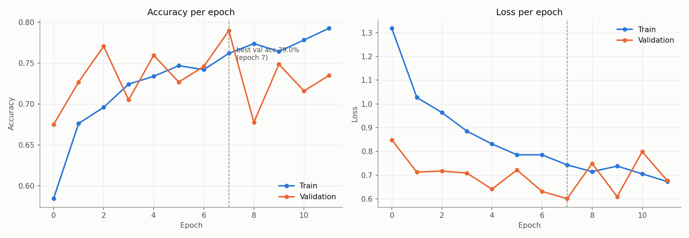
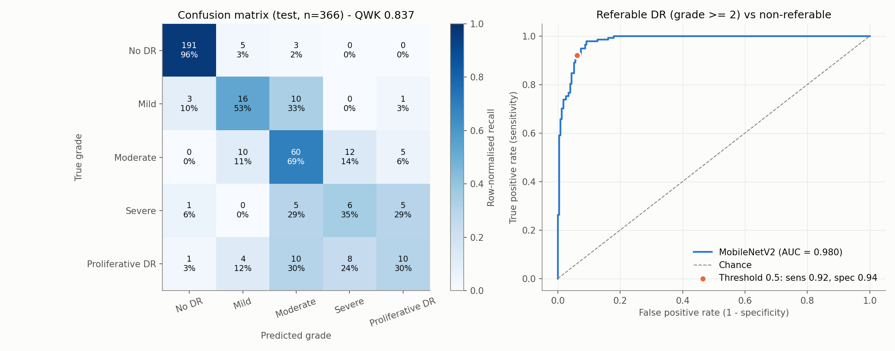
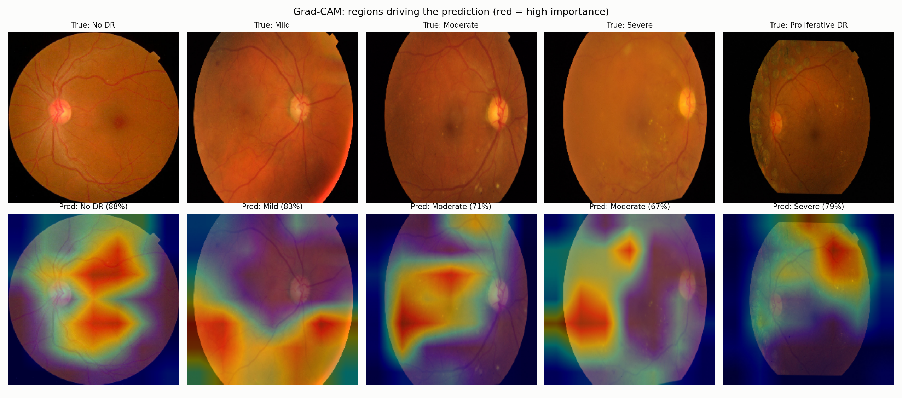

# 👁️ Automated Diabetic Retinopathy Screening for Primary Healthcare

[](https://www.tensorflow.org/)
[](https://keras.io/api/applications/mobilenet/)
[](#model-architecture)
[](https://www.kaggle.com/c/aptos2019-blindness-detection)
[](LICENSE)

> **Clinical Mission:** India has over **77 million diabetic adults** — the second highest globally. Diabetic Retinopathy (DR) affects approximately **18% of this population** and is a leading cause of preventable blindness. A robust, explainable, and validated screening system is essential for deployment in Primary Healthcare Centres (PHCs) across rural and semi-urban India where access to vitreoretinal specialists is critically constrained.

---

## 📌 Table of Contents
- [Clinical Context & Motivation](#-clinical-context--motivation)
- [Diabetic Retinopathy Grading Scale](#-diabetic-retinopathy-grading-scale)
- [Dataset & Distribution](#-dataset--distribution)
- [Model Architecture](#-model-architecture)
- [Training & Performance](#-training--performance)
- [Repository Structure](#-repository-structure)
- [Installation & Setup](#-installation--setup)
- [Inference Quickstart](#-inference-quickstart)
- [PHC Deployment Blueprint](#-phc-deployment-blueprint)
- [Future Roadmap](#-future-roadmap)
- [Citation & Acknowledgements](#-citation--acknowledgements)

---

## 🏥 Clinical Context & Motivation

Diabetic Retinopathy is a microvascular complication of diabetes caused by chronic hyperglycemia that damages retinal capillary endothelial cells, leading to microaneurysms, capillary occlusion, retinal ischemia, and neovascularization.

### The Rural Healthcare Bottleneck in India:
- **Epidemic Scale:** Over 77 million diabetic individuals, projected to rise to 101 million by 2030.
- **Silent Progression:** Early DR stages are asymptomatic. Patients often seek medical attention only when irreversible macular edema or vitreous hemorrhage causes profound vision loss.
- **Doctor-to-Patient Deficit:** In India, the ratio of ophthalmologists to the population in rural regions is less than **1 per 250,000 people**.
- **Solution:** A low-latency, edge-deployable deep learning diagnostic triage tool that enables local health workers (such as ASHA workers and PHC nursing staff) using affordable non-mydriatic fundus cameras to accurately screen, grade, and triage patients for immediate specialist referral.

---

## 🩺 Diabetic Retinopathy Grading Scale

This system adheres to the **International Clinical Diabetic Retinopathy (ICDR)** severity scale (5 distinct diagnostic grades):

| Grade | Severity Level | Clinical Features & Findings | Clinical Action |
|:---:|:---|:---|:---|
| **0** | **No DR** | Healthy retina; no microvascular lesions. | Routine annual re-screening |
| **1** | **Mild NPDR** | Microaneurysms (MAs) only. | Follow-up within 9–12 months |
| **2** | **Moderate NPDR** | More than microaneurysms, dot & blot hemorrhages, hard exudates, cotton wool spots; less than severe NPDR. | Refer to ophthalmologist within 3–6 months |
| **3** | **Severe NPDR** | The **4-2-1 rule**: >20 intraretinal hemorrhages in each of 4 quadrants, venous beading in ≥2 quadrants, or prominent IRMA in ≥1 quadrant. | Urgent referral (within 2–4 weeks) |
| **4** | **Proliferative DR (PDR)** | Neovascularization (NVD/NVE), vitreous or preretinal hemorrhage, tractional retinal detachment. | Immediate ophthalmic emergency intervention |

---

## 📊 Dataset & Distribution

The model is trained and evaluated using the **APTOS 2019 Blindness Detection** benchmark, comprising high-resolution color fundus photographs gathered from clinics across India under varying real-world clinical illumination conditions.

### Dataset Split

| Partition | Total Images | Percentage | Primary Purpose |
|:---|:---:|:---:|:---|
| **Training** | 2,930 | 80% | Model parameter optimization & feature representation |
| **Validation** | 366 | 10% | Hyperparameter tuning & model selection checkpointing |
| **Testing** | 366 | 10% | Unbiased final clinical validation |
| **Total** | **3,662** | **100%** | Full clinical cohort |

### Class Breakdown Across Partitions

| DR Severity Class | Training Set | Validation Set | Testing Set |
|:---|:---:|:---:|:---:|
| **Grade 0 (No DR)** | 1,434 | 172 | 199 |
| **Grade 1 (Mild)** | 300 | 40 | 30 |
| **Grade 2 (Moderate)** | 808 | 104 | 87 |
| **Grade 3 (Severe)** | 154 | 22 | 17 |
| **Grade 4 (Proliferative DR)** | 234 | 28 | 33 |

### Dataset Visualizations

Exploratory data analysis visualizations generated during preprocessing are stored in the [`graphs/`](graphs/) directory:

- 📈 **Class Distribution:** [`graphs/class_distribution.png`](graphs/class_distribution.png) shows the natural class imbalance inherent in real-world clinical screening.
- 🍰 **Dataset Split:** [`graphs/dataset_split.png`](graphs/dataset_split.png) visualizes the 80/10/10 partitioned splits.
- 📊 **Class Comparison Across Splits:** [`graphs/class_comparison.png`](graphs/class_comparison.png) verifies stratified integrity across train, validation, and test subsets.

---

## 🧠 Model Architecture

To guarantee deployability on low-cost computing devices (standard CPU workstations, laptops, or edge devices like Raspberry Pi / Jetson Nano) without requiring high-end GPUs, we employ **MobileNetV2**.

```
Input Image (224 x 224 x 3)
       │
       ▼
┌────────────────────────────────────────┐
│   MobileNetV2 Backbone                 │
│   • ImageNet Pre-trained Weights       │
│   • Inverted Residual Bottlenecks       │
│   • Depthwise Separable Convolutions   │
│   • Feature Map: (7 x 7 x 1280)        │
└────────────────────────────────────────┘
       │
       ▼
┌────────────────────────────────────────┐
│   GlobalAveragePooling2D               │
│   • Flattens spatial dims -> 1280-D    │
└────────────────────────────────────────┘
       │
       ▼
┌────────────────────────────────────────┐
│   Dropout Regularization               │
│   • Mitigates overfitting on minority  │
└────────────────────────────────────────┘
       │
       ▼
┌────────────────────────────────────────┐
│   Dense Output Layer (Softmax)         │
│   • 5 Class Probability Scores (0 to 4)│
└────────────────────────────────────────┘
```

### Architectural Specifications:
- **Backbone:** MobileNetV2 (1.00_224)
- **Total Parameters:** 2,277,201 (8.69 MB)
- **Trainable Parameters:** 6,405 (Top dense classification head)
- **Non-trainable Parameters:** 2,257,984 (Pretrained feature extractor)
- **Model Checkpoint:** [`best_retinopathy.keras`](best_retinopathy.keras)

---

## 📈 Training & Performance

The model was trained using categorical cross-entropy loss and monitored via validation accuracy checkpoints.

### Training Progression Highlights (from [`training_log.csv`](training_log.csv)):

| Epoch | Training Loss | Training Accuracy | Validation Loss | Validation Accuracy | Status |
|:---:|:---:|:---:|:---:|:---:|:---|
| 0 | 1.3186 | 58.43% | 0.8487 | 67.49% | Initial Baseline |
| 1 | 1.0271 | 67.61% | 0.7131 | 72.68% | Converging |
| 2 | 0.9639 | 69.59% | 0.7174 | 77.05% | Improved |
| 4 | 0.8312 | 73.38% | 0.6412 | 75.96% | Loss Reduction |
| **7** | **0.7433** | **76.18%** | **0.6010** | **78.96%** | **Best Checkpoint (`best_retinopathy.keras`)** |
| 9 | 0.7381 | 76.42% | 0.6096 | 74.86% | Stable |
| 11 | 0.6730 | 79.25% | 0.6770 | 73.50% | Final Epoch |

- **Best Validation Accuracy:** **78.96%** (Validation Loss: 0.601)
- **Final Training Accuracy:** **79.25%**



### Held-out Test Set Results (366 images)

| Metric | Value |
|:---|:---:|
| Accuracy (5-class) | 77.3% |
| Macro F1 | 0.559 |
| **Quadratic Weighted Kappa** (official APTOS metric) | **0.837** |
| Referable DR (grade ≥ 2) sensitivity | 92.0% |
| Referable DR specificity | 93.9% |
| Referable DR ROC-AUC | 0.980 |



Full metrics: [`results/metrics.json`](results/metrics.json). Weakest classes are Severe and Proliferative DR (rare, frozen backbone) — the focus of the next phase.

---

## 🔍 Explainability (Grad-CAM)

Grad-CAM heatmaps from the last MobileNetV2 feature map (7×7×1280) show which retinal regions drove each prediction, so a clinician can verify the decision.



---

## 📝 Mid-Term Deliverables

- [`main.ipynb`](main.ipynb) — data audit, EDA, outlier analysis, preprocessing, model, evaluation, Grad-CAM
- [`reports/Mid_Term_Progress_Report.docx`](reports/Mid_Term_Progress_Report.docx) — progress report (`python reports/make_report.py`)
- [`reports/Mid_Term_Presentation.pptx`](reports/Mid_Term_Presentation.pptx) — viva slides (`python reports/make_ppt.py`)

---

## 📂 Repository Structure

```text
Diabetic_Retinopathy_Screening/
├── DataBase/
│   ├── test.csv                # Test split image IDs and ground-truth grades
│   ├── valid.csv               # Validation split image IDs and ground-truth grades
│   ├── train_1.csv             # Training split image IDs and ground-truth grades
│   ├── train_images/           # Training fundus photographs
│   ├── val_images/             # Validation fundus photographs
│   └── test_images/            # Test fundus photographs
├── graphs/
│   ├── class_distribution.png  # Training class distribution histogram
│   ├── dataset_split.png       # Dataset split proportions (Train/Val/Test)
│   └── class_comparison.png    # Multi-split comparison per DR grade
├── reports/                    # Mid-term report (.docx), slides (.pptx) and their generator scripts
├── results/                    # metrics.json and image statistics
├── best_retinopathy.keras      # Saved best Keras model weights (MobileNetV2)
├── training_log.csv            # Per-epoch accuracy and loss metrics log
├── main.ipynb                  # Complete training, evaluation, and visualization notebook
└── README.md                   # Project documentation and clinical overview
```

---

## ⚙️ Installation & Setup

### 1. Clone the Repository
```bash
git clone https://github.com/Shresth-Tiwari/Diabetic_Retinopathy_Screening.git
cd Diabetic_Retinopathy_Screening
```

### 2. Set Up Virtual Environment (Recommended)
```bash
# Windows
python -m venv venv
venv\Scripts\activate

# Linux / macOS
python3 -m venv venv
source venv/bin/activate
```

### 3. Install Dependencies
```bash
pip install -r requirements.txt
```

---

## 🚀 Inference Quickstart

Use the pre-trained [`best_retinopathy.keras`](best_retinopathy.keras) model directly on new fundus images:

```python
import numpy as np
import tensorflow as tf
from tensorflow.keras.preprocessing import image

# 1. Load trained model
model = tf.keras.models.load_model("best_retinopathy.keras")

# 2. Grade mapping
class_labels = {
    0: "No DR",
    1: "Mild DR",
    2: "Moderate DR",
    3: "Severe DR",
    4: "Proliferative DR"
}

def predict_dr(image_path):
    # Load and resize to MobileNetV2 input specifications
    img = image.load_img(image_path, target_size=(224, 224))
    img_array = image.img_to_array(img)
    img_array = np.expand_dims(img_array, axis=0)
    
    # Preprocess matching MobileNetV2 standards
    img_array = tf.keras.applications.mobilenet_v2.preprocess_input(img_array)
    
    # Run inference
    predictions = model.predict(img_array)[0]
    predicted_class = int(np.argmax(predictions))
    confidence = float(predictions[predicted_class]) * 100
    
    return {
        "grade": predicted_class,
        "diagnosis": class_labels[predicted_class],
        "confidence": f"{confidence:.2f}%",
        "action": "Routine Annual Check" if predicted_class < 2 else "Urgent Specialist Referral"
    }

# Example prediction
result = predict_dr("DataBase/val_images/000c1434d8d7.png")
print("Diagnosis:", result["diagnosis"])
print("Confidence:", result["confidence"])
print("Recommended Action:", result["action"])
```

---

## 🏥 PHC Deployment Blueprint

```
[Patient in Rural PHC]
          │
          ▼
[Portable Non-Mydriatic Fundus Camera]
          │
          ▼
[Local Edge PC / Tablet running MobileNetV2 (Offline)]
          │
          ├─────────────────────────────────┐
          ▼                                 ▼
   [Grade 0 / Grade 1]             [Grade 2 / 3 / 4]
   • Non-Referable DR              • Referable / Vision-Threatening DR
   • Health worker counsel         • Tele-ophthalmology alert generated
   • Schedule annual re-screening  • Patient transported to Tertiary Eye Hospital
```

1. **Edge-First Computation:** MobileNetV2 runs in < 60ms per image on a standard quad-core CPU, removing dependency on uninterrupted broadband or cloud compute in rural health centers.
2. **Referral Decision Boundary:** Grades $\ge 2$ represent Referable Diabetic Retinopathy (rDR) and warrant prompt consultation with a specialist.
3. **Preventive Impact:** Intercepts vision impairment before irreversible proliferative fibrovascular proliferation or tractional retinal detachment develops.

---

## 🔮 Future Roadmap

- [x] **Grad-CAM Explainability:** Gradient-weighted Class Activation Mapping heatmaps for every prediction (prototype in `main.ipynb`).
- [ ] **Fine-tuning & ordinal head:** Unfreeze top MobileNetV2 blocks, regression head with optimised thresholds to raise Severe/PDR recall.
- [ ] **Mobile & Web Interface:** Develop an offline-capable Progressive Web App (PWA) and Flutter mobile application for point-of-care screening.
- [ ] **Ben Graham Preprocessing:** Implement automated retinal circular cropping and local contrast normalization to standardize varying clinic camera optics.
- [ ] **Multi-Center Validation:** Prospective testing across diverse demographic cohorts from state health networks in India.

---

## 🤝 Citation & Acknowledgements

- **Dataset:** [APTOS 2019 Blindness Detection](https://www.kaggle.com/c/aptos2019-blindness-detection) hosted by the Asia Pacific Tele-Ophthalmology Society and Aravind Eye Hospital.
- **Deep Learning Framework:** [TensorFlow / Keras](https://www.tensorflow.org/).
- **Backbone Architecture:** MobileNetV2: Inverted Residuals and Linear Bottlenecks ([Sandler et al., 2018](https://arxiv.org/abs/1801.04381)).
